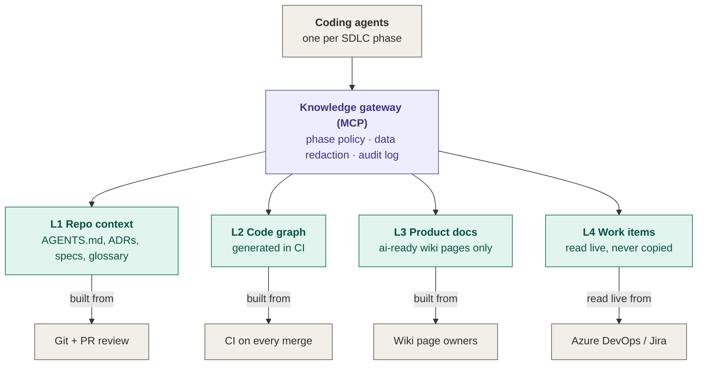

# Agentic SDLC Starter

**Give your AI coding agents the knowledge they need: fresh, scoped to the task, and audited.**

Templates, policies and CI checks to build a *knowledge layer* for AI coding agents (Claude Code, GitHub Copilot, Cursor…) without creating yet another knowledge base that nobody maintains.

---

## The problem

Every team adopting coding agents hits the same wall: the agent writes clean code that breaks your business rules. It doesn't know your domain, your architecture decisions or your current task.

The usual fix is *"let's build a knowledge base for the AI"*: a notes vault, a docs dump, a RAG index. Six weeks later nobody maintains it, and the agent now applies outdated rules **with confidence**. Stale context is worse than no context.

## The approach

| # | Principle | In practice |
|---|---|---|
| 1 | **One source of truth per type of knowledge**, maintained where people already work | Repo context in Git, business rules in the wiki, tasks in the tracker. No second copy. |
| 2 | **Generated indexes are rebuilt by pipelines**, never edited by hand | Code graphs and maps are CI artifacts, versioned per commit. |
| 3 | **One gateway** between agents and knowledge | No direct raw access to the wiki, Git or the tracker. |
| 4 | **Access is denied by default** and granted per SDLC phase | A build agent doesn't need the backlog; a requirements agent doesn't need the code graph. |
| 5 | **Quality is measured**, not assumed | An evaluation set of real questions runs on every change. |

## Architecture



| Layer | Question it answers | Source of truth | Freshness guarantee |
|---|---|---|---|
| **L1** Repo context | How does this repo work? | Git, reviewed by PR | CI fails if structure changes without `AGENTS.md` |
| **L2** Code graph | How does the code connect? | The code itself | Rebuilt on every merge, versioned per commit |
| **L3** Product docs | What are the business rules? | Wiki, named page owners | `ai-ready` label expires after 90 days without review |
| **L4** Work items | What is the current task? | Azure DevOps / Jira | Always live, read on behalf of the user |

### Phase-to-layer access

The phase declared by an agent can only **narrow** access, never widen it:

```
allowed = role ceiling (identity group) ∩ phases allowed by work-item state ∩ declared phase
```

| Phase | L1 Repo context | L2 Code graph | L3 Product docs | L4 Work items |
|---|---|---|---|---|
| Requirements | glossary only | — | ✓ | ✓ |
| Design | ✓ | ✓ | ✓ | ✓ |
| Build | ✓ | ✓ | — | spec only |
| Test / verify | ✓ | ✓ | — | — |
| Release | ✓ | — | — | ✓ |

The full policy is in [`policy/phase-access.yaml`](policy/phase-access.yaml).

---

## What's in this repo

```text
agentic-sdlc-starter/
├── templates/
│   ├── repo/                         # copy into each product repo
│   │   ├── AGENTS.md                 # canonical agent context
│   │   ├── CLAUDE.md                 # one line: @AGENTS.md
│   │   └── docs/
│   │       ├── adr/0000-template.md
│   │       ├── adr/0001-record-architecture-decisions.md
│   │       ├── specs/TEMPLATE.md     # one committed spec per work item
│   │       └── domain/glossary.md
│   ├── wiki/ai-ready-page.md         # template for wiki pages served to agents
│   └── claude/
│       ├── managed-settings.json     # org-wide Claude Code settings
│       ├── project-settings.json     # per-repo Claude Code settings (deny rules + hook)
│       ├── hooks/block-classified.sh # PreToolUse hook: blocks classified files
│       ├── classified-paths.txt      # patterns the hook blocks
│       └── skills/                   # one skill per SDLC phase, plus /ai-readiness
├── policy/phase-access.yaml          # phase → tools policy, deny by default
├── src/, tests/, samples/            # reference knowledge gateway (.NET). See docs/gateway/README.md
├── scanner/                          # AI-readiness scanner (.NET CLI): score + next actions
├── evals/
│   ├── questions.yaml                # evaluation set: real questions + expected sources
│   └── README.md
├── ci/
│   ├── github/agent-context.yml      # GitHub Actions workflow
│   └── azure-devops/agent-context.yml# Azure Pipelines equivalent
└── scripts/
    ├── check-agents-md-freshness.sh  # fails a PR that changes structure without AGENTS.md
    └── check-docs-templates.sh       # ADRs and specs follow their template
```

## Quick start

**1. Add repo context (30 minutes per repo).**
Copy `templates/repo/` into your repo. Fill in `AGENTS.md`: build and test commands, conventions, layering, what agents must never do. Keep it short; agents read it on every session.

**2. Start the glossary first.**
Business terms, acronyms and internal product names are what agents get wrong most. `docs/domain/glossary.md` gives the biggest accuracy gain for the lowest effort. For several repos, keep one shared glossary in a central repo and link to it.

**3. Turn on the CI checks.**
Copy `ci/github/agent-context.yml` to `.github/workflows/` (or the Azure DevOps version) and `scripts/` to your repo. PRs that add a project or move folders without updating `AGENTS.md` now fail.

**4. Protect sensitive files.**
Deploy `templates/claude/managed-settings.json` through your device management, plus the hook. Agents can no longer read `.env` files, seeds, test data or connection strings.

**5. Write 30 evaluation questions.**
Use real questions your team asks (`evals/questions.yaml`). Run them before and after each change to the knowledge layer. When the score drops, **fix the source** (the page, the ADR, the glossary), never the index.

**6. Label wiki pages `ai-ready`.**
Rewrite the 10 most important business-rule pages with `templates/wiki/ai-ready-page.md`, get an owner to review them, and expose only labelled pages to agents.

## Design choices

- **Glossary first.** Agents can't guess what your acronyms mean.
- **Exclude by default.** Test data, seeds, logs and secrets are never indexed. Meeting minutes are never `ai-ready`.
- **AI-generated docs are drafts** until an owner reviews them. Otherwise agents learn another model's guesses as facts.
- **Vector search only when proven necessary**, based on evaluation scores. Most teams don't need it on day one.
- **Tool-agnostic.** Knowledge is plain markdown, exposed through MCP, an open standard. Swap the agent, keep the knowledge.

## Roadmap

- [x] Templates, policy, evaluation set, CI checks
- [x] Reference knowledge gateway v0.1 (.NET, MCP): phase policy, data redaction, audit, Entra ID, repo context and work items, upstream MCP servers. [Run it](docs/gateway/README.md) · [Design](docs/gateway/DESIGN.md). Written against the real SDKs but not yet built with the real packages: expect small fixes on first build.
- [x] AI-readiness scanner: a score out of 100 per repo, with the next actions ranked. [Run it](scanner/README.md) · CI: `ci/github/ai-readiness.yml`, `ci/azure-devops/ai-readiness.yml`
- [ ] Evaluation runner

## Need help rolling this out?

I help teams on the Microsoft stack (.NET, Azure, Entra ID, Azure DevOps) make AI coding agents enterprise-ready: a knowledge layer, access policies, data protection and measured quality.

**AI-Readiness Assessment:** a 3-day audit of your repos, wiki and process, with a readiness score, a risk list and an 8-week rollout plan.

→ [Book a 20-minute call](https://www.mirindra-harivao.com/ai-readiness) · [LinkedIn](https://www.linkedin.com/in/mirindra-harivao-237160135/)

## License

[MIT](LICENSE). Use it, adapt it, share it.
