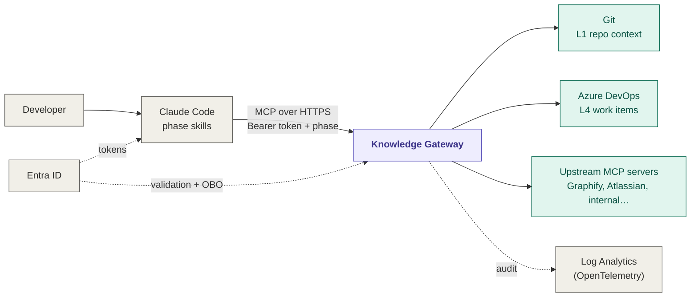
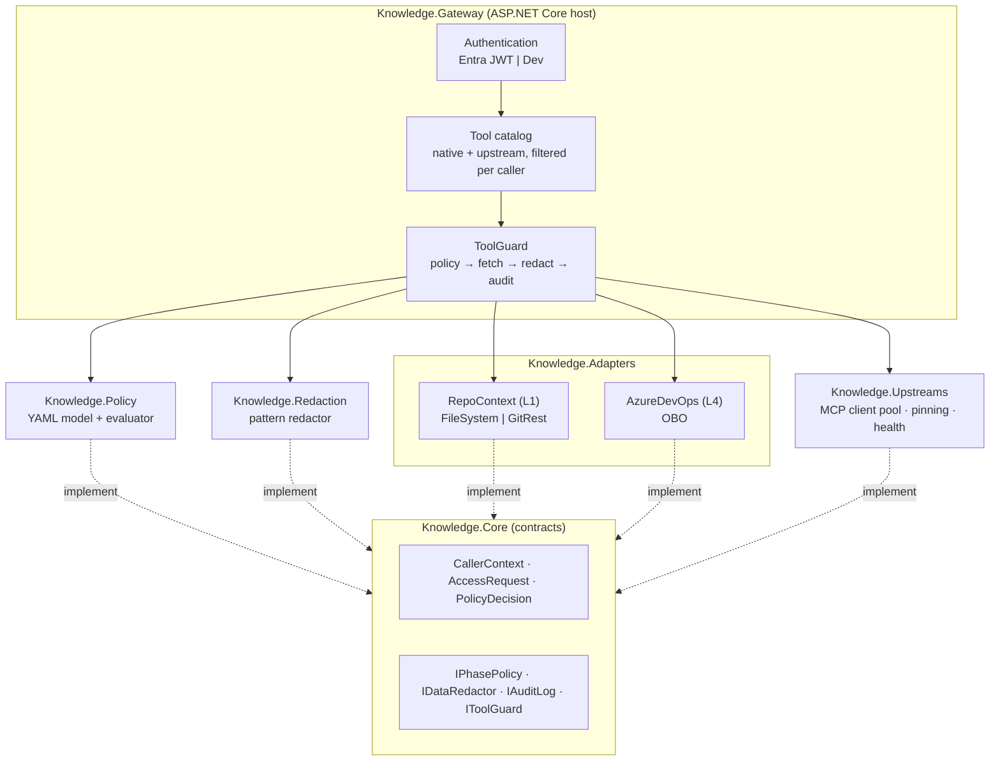
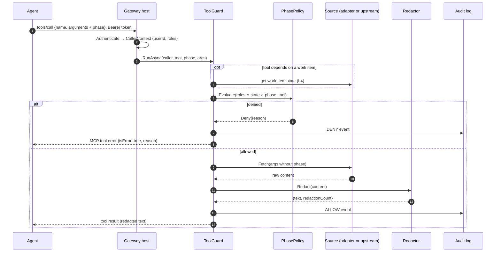
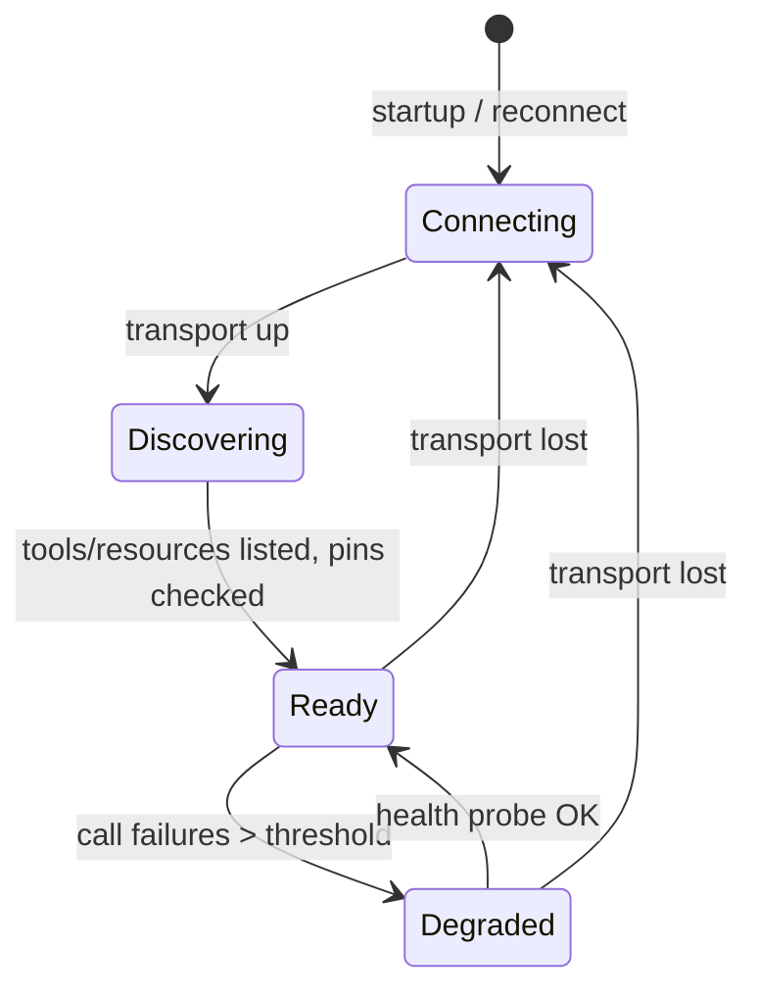

# Knowledge Gateway — Design

| | |
|---|---|
| **Status** | Draft for review |
| **Version** | v0.1 design |
| **Owner** | Mirindra Harivao |
| **Last updated** | 2026-10-15 |

The Knowledge Gateway is a single MCP server that sits between AI coding agents and every source of organisational knowledge. It decides **what each agent may know in each SDLC phase**, removes sensitive data before it reaches the model, and records every access.

---

## 1. Goals and non-goals

### Goals

| # | Goal | Measured by |
|---|---|---|
| G1 | Agents get the right knowledge for their SDLC phase, and nothing more | Policy tests: one case per matrix cell |
| G2 | No sensitive data reaches the model through the gateway | Redaction tests on known identifier patterns |
| G3 | Every access is attributable to a real person and auditable | One audit event per call, allowed or denied |
| G4 | Any MCP server can be connected behind the gateway, under the same rules | Upstream tools are denied until listed and pinned in the policy |
| G5 | Anyone can try it in 2 minutes, without Azure | Dev mode serves a sample repo locally |
| G6 | The organisation can operate it alone | Plain .NET, one container, policy in Git |

### Non-goals (v0.1)

- **Writing** to any source. The gateway is read-only. State transitions, comments and completed hours stay in the developer's own tracker tools, with explicit confirmation.
- Semantic or vector search. Added later, only if the evaluation set shows retrieval misses.
- A user interface. Configuration is files in Git; audit is read in Log Analytics or the console.
- Hosting knowledge. The gateway stores nothing; every layer is read from its source of truth.

---

## 2. Context



Agents are configured (through Claude Code managed settings) to reach knowledge **only** through the gateway. Direct access to the wiki, Git API or tracker MCP is removed from the agent's allowlist.

---

## 3. Architecture

### 3.1 Components



| Project | Responsibility | Depends on |
|---|---|---|
| `Knowledge.Core` | Contracts and value types only | nothing |
| `Knowledge.Policy` | Load and validate `phase-access.yaml`; evaluate access | Core, YamlDotNet |
| `Knowledge.Redaction` | Detect and mask sensitive identifiers | Core |
| `Knowledge.Adapters` | L1 repo context and L4 Azure DevOps sources | Core, Microsoft.Identity.Web (OBO) |
| `Knowledge.Upstreams` | Connect to upstream MCP servers, discover, pin, forward | Core, ModelContextProtocol |
| `Knowledge.Gateway` | Host: auth, MCP endpoint, tool catalog, `ToolGuard`, telemetry | all of the above |

Rule: **only `Knowledge.Gateway` references ASP.NET Core.** Policy, redaction and adapters are plain libraries, unit-testable without a host.

### 3.2 Request pipeline



**Invariant:** no code path returns source content to the agent without passing through `ToolGuard`. Tools are thin: they parse arguments and hand a fetch delegate to the guard.

---

## 4. Contracts (`Knowledge.Core`)

```csharp
public sealed record CallerContext(string UserId, IReadOnlySet<string> Roles, string AuthMode);

public sealed record AccessRequest(
    CallerContext Caller,
    string Tool,            // native name or "upstream.tool"
    string DeclaredPhase,
    string? WorkItemState); // null when unknown or not applicable

public sealed record PolicyDecision(bool Allowed, string Reason)
{
    public static PolicyDecision Allow() => new(true, "allowed");
    public static PolicyDecision Deny(string reason) => new(false, reason);
}

public sealed record RedactionResult(string Text, int RedactionCount, IReadOnlyDictionary<string, int> ByKind);

public interface IPhasePolicy
{
    PolicyDecision Evaluate(AccessRequest request);
    IReadOnlySet<string> ToolsVisibleTo(CallerContext caller);   // for tools/list
}

public interface IDataRedactor { RedactionResult Redact(string text); }

public interface IAuditLog { void Write(AuditEvent e); }

public interface IToolGuard
{
    Task<string> RunAsync(ToolInvocation invocation, Func<CancellationToken, Task<string>> fetch, CancellationToken ct);
}

public sealed record ToolInvocation(CallerContext Caller, string Tool, string Phase, string Layer, string? WorkItemState);
```

---

## 5. Authentication

Selected by `Auth:Mode`.

| Mode | Use | Identity | Groups → roles |
|---|---|---|---|
| `Entra` | Any shared or production deployment | JWT validated with `Microsoft.Identity.Web` (issuer, audience, signature, expiry) | `groups` claim (object IDs) mapped to role names in config |
| `Dev` | Local try-out and tests | Fixed user and roles from config | Roles listed directly |

```json
"Auth": {
  "Mode": "Entra",
  "Entra": {
    "Instance": "https://login.microsoftonline.com/",
    "TenantId": "<tenant-id>",
    "ClientId": "<gateway-app-id>",
    "Audience": "api://knowledge-gateway"
  },
  "RoleMap": {
    "6f1c…-developers-group-id": "developers",
    "a2b9…-product-owners-group-id": "product-owners"
  },
  "Dev": { "UserId": "dev@localhost", "Roles": ["developers"] }
}
```

Rules:
- **Dev mode refuses to start** when `ASPNETCORE_ENVIRONMENT` is `Production`, and every audit event carries `authMode: Dev`.
- A token with no mapped role gets **no tools** (empty `tools/list`), not an error.
- Groups overage (more than ~200 groups, no `groups` claim) is resolved through Microsoft Graph `checkMemberGroups`, limited to the mapped group IDs, and cached for the token lifetime.
- The incoming token is **never forwarded** to any source. Downstream calls use OBO, a managed identity or a secret (see §7, §8).

---

## 6. Policy

### 6.1 Evaluation

```
allowed = tool ∈ roleCeiling(caller.roles)
        ∧ phase ∈ phasesAllowedBy(workItemState)      (skipped when state is null)
        ∧ tool ∈ phase.tools
```

Evaluation order and denial reasons (returned to the agent and audited):

| Step | Check | Reason on failure |
|---|---|---|
| 1 | Phase exists | `Unknown phase 'x'.` |
| 2 | Tool exists in the catalog | `Unknown tool 'x'.` |
| 3 | Work-item state allows phase | `Work item in state 'Active' does not allow phase 'requirements'.` |
| 4 | Role ceiling allows tool | `Your role does not allow 'x'.` |
| 5 | Phase allows tool | `'x' is not available in phase 'build'.` |
| 6 | Upstream tool pin matches (upstream only) | `'x' changed since it was approved; ask an administrator to re-approve it.` |

Denial reasons never reveal other users' data or the content of the policy beyond the failing rule.

### 6.2 Policy file schema (extends the starter's `policy/phase-access.yaml`)

```yaml
defaultDecision: deny            # required; startup fails otherwise

tools:                           # native tools
  get_glossary_term: { layer: L1 }
  search_adrs:       { layer: L1 }
  get_spec:          { layer: L1, needsWorkItemState: true }
  get_work_item:     { layer: L4, needsWorkItemState: true }

phases:
  requirements: { tools: [get_glossary_term, get_work_item, atlassian.search] }
  design:       { tools: [get_glossary_term, search_adrs, get_work_item, graphify.query_graph, graphify.get_neighbors] }
  build:        { tools: [get_glossary_term, search_adrs, get_spec, graphify.query_graph] }
  test:         { tools: [get_spec, graphify.query_graph] }
  release:      { tools: [get_spec, get_work_item, search_adrs] }

workItemStates:
  New:      [requirements, design]
  Approved: [design, build]
  Active:   [build, test]
  Resolved: [test, release]
  Closed:   []

roles:
  developers: "*"
  product-owners: [get_glossary_term, get_work_item, atlassian.search]

upstreams:                       # see §8
  graphify:
    layer: L2
    tools:
      query_graph:   { pin: "sha256:3f9a…" }
      get_neighbors: { pin: "sha256:a71c…" }
    resources:
      allow: ["graphify://node/*"]
      phases: [design, build]
```

### 6.3 Startup validation (fail fast)

The gateway refuses to start if:
- `defaultDecision` is missing or not `deny`;
- a phase, role or state references a tool that doesn't exist (native or declared upstream);
- an upstream tool is referenced in a phase but has no `pin`;
- a work-item state references an unknown phase.

The same validation runs as a CI test on the real policy file.

---

## 7. Native layers (v0.1)

### 7.1 L1 Repo context

| Tool | Input (besides `phase`) | Reads | Output |
|---|---|---|---|
| `get_glossary_term` | `term` | `docs/domain/glossary.md` (+ shared glossary repo) | The matching table row(s) as markdown, or "not found" with the 3 closest terms |
| `search_adrs` | `query`, `status?` | `docs/adr/*.md` | Up to 5 ADRs: number, title, status, Decision section; full text on exact number match |
| `get_spec` | `workItemId` | `docs/specs/<workItemId>.md` | The spec as markdown |

Sources (`IRepoContextSource`):
- `FileSystem`: a local folder. Used in dev mode with `samples/demo-repo`.
- `GitRest`: Azure Repos or GitHub REST API, **default branch only**, read-only managed identity or GitHub App token. Responses cached by `(repo, path, commitSha)`; cache invalidated when the branch head moves (checked at most every 60 s).

Search in v0.1 is lexical (title and heading match, then body term frequency). Good enough for tens of ADRs; semantic search is a later, measured decision.

### 7.2 L4 Azure DevOps work items

| Tool | Input | Output |
|---|---|---|
| `get_work_item` | `id` | Title, state, description, acceptance criteria, comments (latest 20), links — as markdown |

- Called **on behalf of the user** (OBO, `ITokenAcquisition`, scope `499b84ac-1321-427f-aa17-267ca6975798/.default`). An agent can never read a work item its user can't read.
- **Field allowlist** from the policy file; attachments and custom fields dropped.
- The same call provides the **work-item state** for the policy check. State lookups are cached for 30 s per `(user, id)`.
- Jira (Atlassian OAuth 2.0, no Entra OBO) is a v0.3 adapter behind the same `IWorkItemSource`.

---

## 8. Upstream MCP servers

### 8.1 Lifecycle



1. **Connect** with the configured transport: `Stdio` (the gateway starts the process) or `Http` (Streamable HTTP).
2. **Discover** `tools/list`, `resources/list` and `resources/templates/list`. Re-discover on `notifications/tools/list_changed` and every 10 minutes.
3. **Pin check.** For each tool declared in the policy, compute `sha256(canonical JSON of name + description + inputSchema)`. If it differs from the `pin`, the tool is **disabled** and a `PIN_MISMATCH` warning is logged. Tools the upstream offers but the policy doesn't declare are **never exposed**.
4. **Expose** approved tools as `<upstream>.<tool>`, with the input schema rewritten to add a required `phase` property. Descriptions are prefixed with `[via <upstream>]`.

### 8.2 Call forwarding

```
agent → graphify.query_graph {phase: "build", query: "InvoiceService"}
gateway: ToolGuard(policy on "graphify.query_graph", phase "build")
       → upstream "graphify": tools/call query_graph {query: "InvoiceService"}   (phase removed)
       ← content[]: text items kept; image/audio/resource-blob items dropped (logged)
       → redact → size cap (default 64 KB, truncated with a note) → audit (upstream: graphify)
```

Resources follow the same path: `upstream://graphify/node/123` is translated to the upstream's own URI, checked against `resources.allow` and `resources.phases`, read, redacted and audited.

### 8.3 Configuration

```json
"Upstreams": [
  {
    "Name": "graphify",
    "Transport": "Stdio",
    "Command": "python",
    "Args": ["-m", "graphify.serve", "/graphs/billing-api/graph.json"],
    "Auth": { "Mode": "None" },
    "TimeoutSeconds": 15
  },
  {
    "Name": "atlassian",
    "Transport": "Http",
    "Url": "https://<mcp-server-url>",
    "Auth": { "Mode": "KeyVaultSecret", "Secret": "atlassian-mcp-token" },
    "TimeoutSeconds": 20
  }
]
```

Auth modes per upstream: `None`, `KeyVaultSecret` (static bearer or API key), `ManagedIdentity` (token for a configured scope), `Obo` (token exchanged for the upstream's audience). **Pass-through of the caller's token is not supported.**

### 8.4 Upstream rules

| Concern | Rule |
|---|---|
| Unknown tools | Never exposed (deny by default) |
| Changed definitions | Disabled until re-approved (`upstreams approve <name>`) |
| Sampling, elicitation, roots requests from the upstream | Refused |
| Non-text content | Dropped by default; allowlisted per upstream if needed |
| Result size | Capped (default 64 KB) |
| Failures | Per-upstream timeout, 1 retry on transient errors, circuit breaker (5 failures / 30 s open). Other tools keep working. |
| Isolation | Stdio upstreams run as a non-root user with no access to the gateway's secrets |

### 8.5 Admin commands

```bash
dotnet run --project src/Knowledge.Gateway -- upstreams list              # discovered tools and pin status
dotnet run --project src/Knowledge.Gateway -- upstreams approve graphify  # prints pins to paste into the policy
```

`approve` never edits the policy file itself: the pins go through a pull request reviewed by CODEOWNERS.

---

## 9. Redaction

Applied to **every** tool and resource result, native or upstream.

| Kind | Detection | Replacement |
|---|---|---|
| Email | RFC 5322-lite pattern | `[EMAIL]` |
| Phone | E.164 and Belgian/French national formats | `[PHONE]` |
| IBAN | Country code + checksum (mod 97) | `[IBAN]` |
| Belgian national register number | `YY.MM.DD-XXX.CC` with mod-97 check | `[NATIONAL_ID]` |
| Payment card | 13–19 digits with Luhn check | `[CARD]` |
| JWT | `eyJ…\.…\.…` | `[TOKEN]` |
| Secrets | Known key prefixes (`sk-`, `ghp_`, `AKIA`, `xox`) and `password=`/`pwd=` pairs | `[SECRET]` |
| Connection strings | `Server=…;`, `Data Source=…;`, `AccountKey=…` | `[CONNECTION_STRING]` |

- Patterns with a checksum are only replaced when the checksum passes, to keep false positives low.
- Organisations can add patterns in config (`Redaction:CustomPatterns`), each with a required test sample.
- Redaction is **defence in depth**, not a classification system: classified files are also excluded at source (deny rules, field allowlists, `ai-ready` labels).

---

## 10. Audit

One structured event per tool call or resource read, emitted through `ILogger` with OpenTelemetry.

```json
{
  "event": "knowledge.access",
  "decision": "ALLOW",
  "userId": "8a1f…",
  "roles": ["developers"],
  "authMode": "Entra",
  "phase": "build",
  "tool": "graphify.query_graph",
  "layer": "L2",
  "upstream": "graphify",
  "workItemState": null,
  "reason": "allowed",
  "chars": 4120,
  "redactions": { "EMAIL": 1 },
  "durationMs": 182,
  "traceId": "4bf92f3577b34da6a3ce929d0e0e4736"
}
```

- **No content is logged**: no arguments' values for free-text fields, no results. Only metadata. Argument *names* are logged; `term`, `id` and `workItemId` values are logged because they're identifiers, not content.
- Exporters: console (dev), Azure Monitor (when `APPLICATIONINSIGHTS_CONNECTION_STRING` is set).
- Suggested alerts: spike of `DENY` for one user (probing or mis-configured skill), any `PIN_MISMATCH`, upstream circuit open.

---

## 11. Errors returned to agents

| Situation | MCP response |
|---|---|
| Invalid or missing token | HTTP 401 before MCP (no tool list) |
| Policy denial | Tool result with `isError: true` and the denial reason |
| Source not found (term, ADR, spec, work item) | Normal result: "not found", plus suggestions where possible |
| Source unavailable / upstream circuit open | `isError: true`: "Source temporarily unavailable; retry later." |
| Invalid arguments | `isError: true` with the validation message |

Denials are tool errors, not protocol errors, so the agent can read the reason and adapt (for example, ask for the spec instead of the backlog).

---

## 12. Security

| Threat | Mitigation |
|---|---|
| Agent spoofs a broader phase | Phase only narrows: intersection with role and work-item state |
| Agent calls a hidden tool by name | Every call re-checked by `ToolGuard`; the filtered list is a convenience, not the control |
| Prompt injection through source content | Redaction and size caps; agents are told (skill instructions) that tool results are data, not instructions |
| Upstream tool poisoning | Pinned definitions; unknown tools never exposed; sampling/elicitation refused |
| Token replay to other services | Audience validation; no pass-through; OBO per downstream audience |
| Sensitive data in sources | Exclusion at source + field allowlists + redaction |
| Dev mode left on in production | Startup refusal in `Production`; `authMode` in every audit event |
| Gateway compromise | Read-only identities everywhere; secrets in Key Vault; private networking; no data stored |

---

## 13. Hosting and operations

- **Container:** one image, `mcr.microsoft.com/dotnet/aspnet:10.0` base, non-root user. Python is added only in the image variant that runs stdio upstreams such as Graphify.
- **Azure:** Container Apps in the required data-residency region, VNet integration, private endpoint, managed identity for Git and Key Vault, Application Insights for audit. Bicep in `infra/` (v0.2).
- **Health:** `/health/live` (process) and `/health/ready` (policy loaded, at least one source reachable; upstream status reported but not blocking).
- **Configuration changes:** policy and upstream changes go through pull requests and a redeploy. Hot reload is out of scope for v0.1 on purpose: a reviewed deployment is the change-control record.

---

## 14. Testing

| Level | Project | What it proves |
|---|---|---|
| Unit | `Knowledge.Policy.Tests` | One `[Theory]` case per matrix cell; every denial reason; startup validation rejects bad files; the real `policy/phase-access.yaml` loads |
| Unit | `Knowledge.Redaction.Tests` | Each pattern masks valid samples, ignores invalid checksums, leaves ordinary text unchanged |
| Unit | `Knowledge.Upstreams.Tests` | Pin computation is stable; changed description disables the tool; namespacing and `phase` stripping |
| Integration | `Knowledge.Gateway.IntegrationTests` | `WebApplicationFactory` + SDK MCP client: tool list filtered by role; denied call returns `isError` and is audited; allowed call returns redacted content; an in-process fake upstream is exposed, called and pinned |
| Contract | `samples/demo-repo` | Every native tool returns the expected sample content in dev mode |
| Quality | `evals/questions.yaml` | Agent-level evaluation, run outside CI against a deployed gateway |

---

## 15. Repository layout

```text
src/
├── Knowledge.Core/
├── Knowledge.Policy/
├── Knowledge.Redaction/
├── Knowledge.Adapters/
│   ├── RepoContext/        # FileSystemSource, GitRestSource
│   └── AzureDevOps/        # AzureDevOpsWorkItemSource (OBO)
├── Knowledge.Upstreams/    # UpstreamPool, UpstreamConnection, PinCalculator
└── Knowledge.Gateway/      # Program.cs, Auth/, Tools/, ToolGuard, Catalog/
tests/
├── Knowledge.Policy.Tests/
├── Knowledge.Redaction.Tests/
├── Knowledge.Upstreams.Tests/
└── Knowledge.Gateway.IntegrationTests/
samples/demo-repo/
policy/phase-access.yaml    # shared with the templates
Dockerfile
Knowledge.Gateway.sln
```

---

## 16. Roadmap

| Version | Scope |
|---|---|
| **v0.1** | Core, policy, redaction, audit, Entra + Dev auth, L1 (FileSystem, GitRest), L4 Azure DevOps (OBO), upstream connector (stdio + HTTP, pinning), Docker, tests |
| v0.2 | L3 native Confluence adapter (`ai-ready` label, 90-day freshness, storage-format → markdown), L2 graph from CI artifacts in Blob, Bicep for Container Apps |
| v0.3 | Jira adapter (Atlassian OAuth 2.0), per-user Confluence OAuth, groups overage via Graph, policy UI (read-only view of the matrix) |
| Later | Semantic search for L3 if evaluation scores require it |

---

## 17. Open questions

1. **Confluence Cloud or Data Center?** Changes the L3 auth model and some endpoints (v0.2).
2. **Graphify: CI artifact (`graph.json` per commit) or upstream MCP?** v0.1 supports the upstream route out of the box; the CI route gives versioned, shared graphs.
3. **Shared glossary location:** one central repo for all products, or per product family?
4. **Data residency region** and whether Application Insights is acceptable for audit, or a dedicated Log Analytics workspace is required.
5. **Retention** of audit events (suggested: 1 year, aligned with the organisation's access-log policy).
